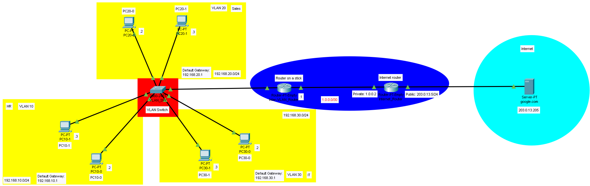

# CiscoPT_VLAN-Implementation

## Description
  This project demonstrates a network designed in Cisco Packet Tracer. The primary goals are to learn how to create and configure VLANs and implement a "Router on a Stick" configuration. This setup connects to a switch using
a single port, providing communication between virtual networks.

  Additionally, the simulation includes a router configured with Network Address Translation (NAT). This router features a connection to the "Router on a Stick" on the private side and a connection to a server that
simulates internet access on its public side.

## Network Diagram

## Network Componets
| Component Type | Model                      | Quantity |
|----------------|----------------------------|----------|
| Switch         | Cisco 2960                 | 1        |
| Router         | Cisco PT-Empty(1CGE-ports) | 2        |
| PC             | Generic PC                 | 6        |
| Server         | Cisco Server               | 1        |

## IP Addressing Scheme
| Device            | Interface     | IP Address       | Subnet Mask       | Default Gateway |
|-------------------|---------------|------------------|-------------------|-----------------|
| VLAN Switch:      |               |                  |                   |                 |
|   VLAN 10         | Range F0/2-4  |                  |                   |                 |
|   VLAN 20         | Range F0/5-7  |                  |                   |                 |
|   VLAN 30         | Range F0/8-10 |                  |                   |                 |
|   Default GW      | F0/1          |                  |                   |                 |
| PC10-0            | NIC           | 192.168.10.2     | 255.255.255.0     | 192.168.10.1    |
| PC10-1            | NIC           | 192.168.10.3     | 255.255.255.0     | 192.168.10.1    |
| PC20-0            | NIC           | 192.168.20.2     | 255.255.255.0     | 192.168.20.1    |
| PC20-1            | NIC           | 192.168.20.3     | 255.255.255.0     | 192.168.20.1    |
| PC30-0            | NIC           | 192.168.30.2     | 255.255.255.0     | 192.168.30.1    |
| PC30-1            | NIC           | 192.168.30.3     | 255.255.255.0     | 192.168.30.1    |
| Router on a stick | G0/0          |                  |                   |                 |
|   HR              | G0/0.10       | 192.168.10.1     | 255.255.255.0     |                 |
|   Sales           | G0/0.20       | 192.168.20.1     | 255.255.255.0     |                 |
|   IT              | G0/0.30       | 192.168.30.1     | 255.255.255.0     |                 |
|                   | G0/1          | 1.0.0.1          | 255.255.255.252   |                 |
| Internet Router   | G0/0          | 1.0.0.2          | 255.255.255.252   |                 |
|                   | G0/1          | 203.0.13.5       | 255.255.255.0     |                 |
| google.com        | NIC           | 203.0.13.205     | 255.255.255.0     | 203.0.13.5      |

## Configuration Details
### VLAN Switch
Switch> enable

Switch# conf t

Switch(config)# hostname VLAN_SW

VLAN_SW(config)# vlan 10

VLAN_SW(config-vlan)# name HR

VLAN_SW(config-vlan)# exit

VLAN_SW(config)# vlan 20

VLAN_SW(config-vlan)# name Sales

VLAN_SW(config-vlan)# exit

VLAN_SW(config)# vlan 30

VLAN_SW(config-vlan)# name IT

VLAN_SW(config-vlan)# exit

VLAN_SW(config)# interface f0/1

VLAN_SW(config-if)# switchport mode trunk

VLAN_SW(config-if)# exit

VLAN_SW(config)# interface range f0/2-4

VLAN_SW(config-if-range)# switchport mode access

VLAN_SW(config-if-range)# switchport access vlan 10

VLAN_SW(config-if-range)# exit

VLAN_SW(config)# interface range f0/5-7

VLAN_SW(config-if-range)# switchport mode access

VLAN_SW(config-if-range)# switchport access vlan 20

VLAN_SW(config-if-range)# exit

VLAN_SW(config)# interface range f0/8-10

VLAN_SW(config-if-range)# switchport mode access

VLAN_SW(config-if-range)# switchport access vlan 30

VLAN_SW(config-if-range)# exit

VLAN_SW(config)# exit

VLAN_SW# copy running-config startup-config

VLAN_SW# exit

### Router on a stick
Router> enable

Router# conf t

Router(config)# hostname Inter-VLAN_Router

Inter-VLAN_Router(config)# interface g0/0.10

Inter-VLAN_Router(config-subif)# encapsulation dot1q 10

Inter-VLAN_Router(config-subif)#ip address 192.168.10.1 255.255.255.0

Inter-VLAN_Router(config-subif)# exit

Inter-VLAN_Router(config)# interface g0/0.20

Inter-VLAN_Router(config-subif)# encapsulation dot1q 20

Inter-VLAN_Router(config-subif)# ip address 192.168.20.1 255.255.255.0

Inter-VLAN_Router(config-subif)# exit

Inter-VLAN_Router(config)# interface g0/0.30

Inter-VLAN_Router(config-subif)# encapsulation dot1q 30

Inter-VLAN_Router(config-subif)# ip address 192.168.30.1 255.255.255.0

Inter-VLAN_Router(config-subif)# exit

Inter-VLAN_Router(config)# interface g0/0

Inter-VLAN_Router(config-if)# no shutdown

Inter-VLAN_Router(config-if)# exit

Inter-VLAN_Router(config)# interface g1/0

Inter-VLAN_Router(config-if)# ip address 1.0.0.1 255.255.255.252

Inter-VLAN_Router(config-f)# no shutdown

Inter-VLAN_Router(config-if)# exit

Inter-VLAN_Router(config)# ip route 0.0.0.0 0.0.0.0 1.0.0.2

Inter-VLAN_Router(config)# exit

Inter-VLAN_Router# copy running-config startup-config

Inter-VLAN_Router# exit

### Internet Router
Router> enable

Router# conf t

Router(config)# hostname Internet_Router

Internet_Router(config)# interface g0/0

Internet_Router(config-if)# ip address 1.0.0.1 255.255.255.252

Internet_Router(config-if)# ip nat inside

Internet_Router(config-if)# no shutdown

Internet_Router(config-if)# exit

Internet_Router(config)# interface g1/0

Internet_Router(config-if)# ip address 203.0.13.5 255.255.255.0

Internet_Router(config-if)# ip nat outside

Internet_Router(config-if)# exit

Internet_Router(config)# ip route 192.168.10.0 255.255.255.0 1.0.0.1

Internet_Router(config)# ip route 192.168.20.0 255.255.255.0 1.0.0.1

Internet_Router(config)# ip route 192.168.30.0 255.255.255.0 1.0.0.1

Internet_Router(config)# access-list 1 permit 192.168.10.0 0.0.0.255

Internet_Router(config)# access-list 1 permit 192.168.20.0 0.0.0.255

Internet_Router(config)# access-list 1 permit 192.168.30.0 0.0.0.255

Internet_Router(config)# ip nat inside source list 1 interface GigabitEthernet1/0 overload

Internet_Router(config)# exit

Internet_Router# copy running-config startup-config

Internet_Router# exit

## Test Scenarious
To ensure connectivity and functionality, the following tests were performed:

  * Ping tests: Successful pings between routers and PCs.
  * Connectivity tests: All devices were able to communicate as intended.

## Conclusion
  The project successfully meets its intended objectives by demonstrating a fully functional network. PCs within the VLANs can communicate with each other as well as with hosts from other VLANs. The internet
router effectively handles Network Address Translation (NAT), allowing all hosts to successfully reach the internet-simulating router from their respective VLANs.

Key Achievements:

  * Successful Inter-VLAN Communication: PCs within different VLANs communicated seamlessly.
  * Effective NAT Handling: The router managed NAT properly, facilitating internet access.
  * Robust Network Design: Overall, the network functions as intended, showcasing the design principles learned.

## Future Improvements
To enhance this network, the following features could be implemented:

  * Implementing Password Protection: Secure switches and routers by configuring passwords for access to prevent unauthorized access.
  * Setting Access Control Lists (ACLs): Configure ACL rules to restrict unwanted traffic and enhance network security.

## License
This project is licensed under the CC0-1.0 Universal - see the LICENSE file for details.
